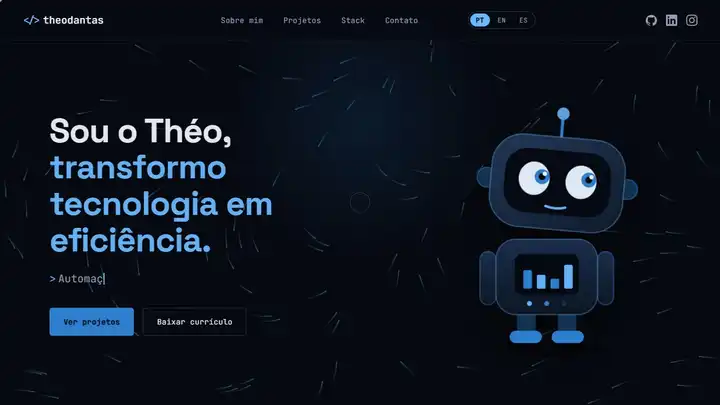

<h1 align="center">Portfólio - Théo Dantas 💻</h1>

<h4 align="center"><a href="https://theodantas.com.br">Confira o projeto aqui</a></h4>

---

## 📌 Sobre o Projeto

Este projeto é meu portfólio pessoal, criado para apresentar minha trajetória, projetos e conhecimentos na área de tecnologia, reunindo alguns dos trabalhos que desenvolvi ao longo da minha formação e dos meus estudos!

## 🛠 Tecnologias utilizadas:

O site é 100% estático (sem build, sem dependências), então roda direto no GitHub Pages:

    
    
    

## ✨ Recursos

- **Três idiomas** (PT · EN · ES): o seletor fica no menu; a escolha é salva no navegador e, na primeira visita, o idioma do navegador é respeitado. O português fica no `index.html` e as traduções em `assets/js/i18n.js`.
- **Mascote interativo** em SVG: os olhos e a cabeça seguem o cursor, ele pisca e reage ao clique.
- **Campo de fluxo** no topo: partículas com rastros, redemoinho no cursor e onda de choque ao clicar.
- **Foto em cena 3D** com os ícones da stack orbitando em profundidade.
- Barra de progresso de rolagem, destaque da seção atual no menu, menu mobile e *tilt* 3D nos cards.
- Respeita `prefers-reduced-motion`, funciona sem JavaScript (conteúdo visível) e tem foco visível para teclado.

## 🖼 Imagens

As capas e ícones usados no site são arquivos `.webp` otimizados (`assets/images/*.webp`). Os GIFs e PNGs originais continuam na pasta apenas como fonte/backup.

## 📚 Alguns conceitos aplicados

✔️ Semântica HTML e acessibilidade;

✔️ Design responsivo com CSS Variables e Grid/Flexbox;

✔️ Animações em Canvas 2D, SVG e CSS 3D (`preserve-3d`);

✔️ Internacionalização sem framework.

---

<table align="center">
  <tr>
    <td>
      
    </td>
    <td>
      Feito por <a href="https://github.com/theodantas">Théo Dantas.</a> 🙋‍♂️
    </td>
  </tr>
</table>
